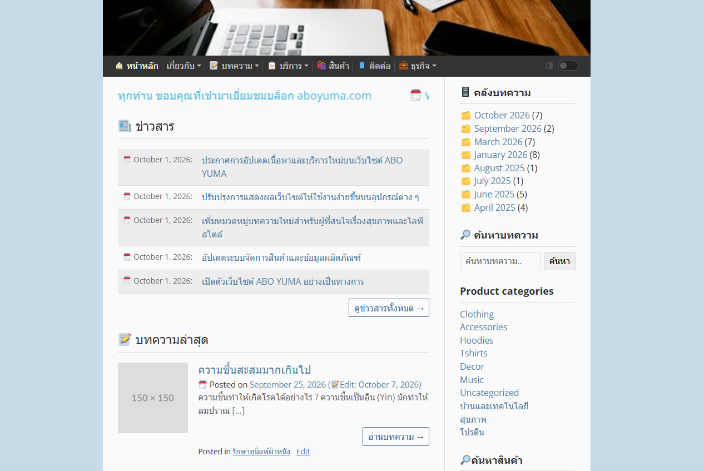
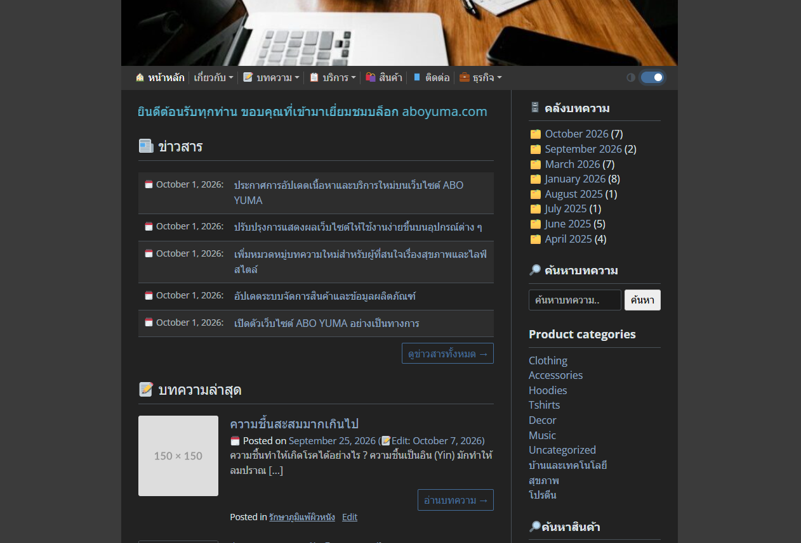
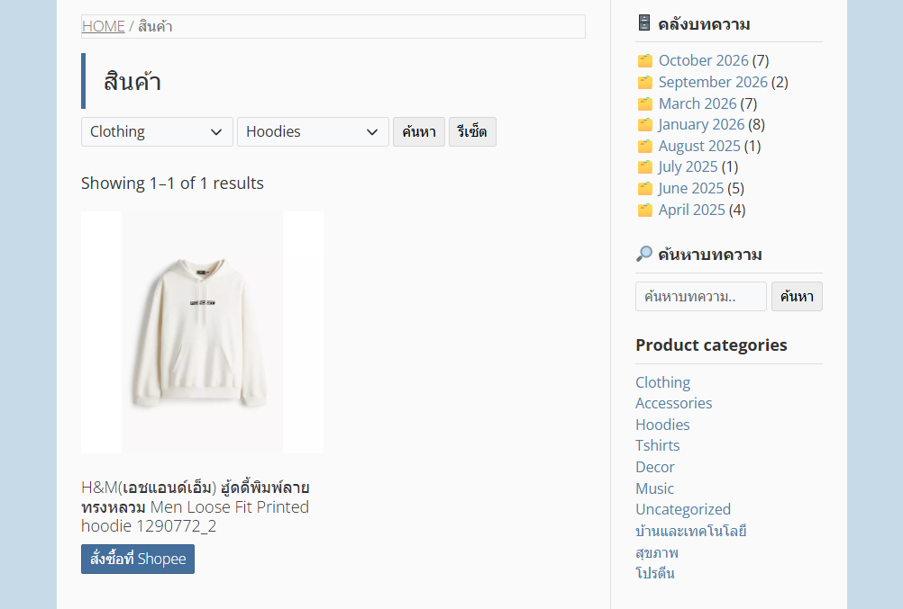

# ABO YUMA - UNDERSTRAP


**A custom WordPress theme built on top of the [Understrap](https://understrap.com/) theme.**

Originally developed for a personal website. 
The design concept combines blogging and commerce with a classic, old-school layout inspired by traditional blog websites. 

**NOTE:**<br>
I discontinued this project and decided to develop my own customized version of the [Twenty Ten](https://wordpress.org/themes/twentyten/) theme.

### ☀️ Light Mode

<div align="center">
  
</div>

### 🌙 Dark Mode

<div align="center">
  
</div>

### 🔎 WooCommerce AJAX Product Filtering by Category and Subcategory

<div align="center">
  
</div>

### 🛍️ WooCommerce Support

- WooCommerce integration with additional custom product fields
- Built-in AJAX product search and filtering by category and subcategory
- AJAX pagination for product listings

---

## 📦 Installation

1. Navigate to the theme directory:

   ```bash
   cd wp-content/themes/aboyuma-understrap
   ```

2. Install dependencies:

   ```bash
   npm install
   ```

3. Build theme assets:

   ```bash
   npm run dist
   ```

4. Activate the **ABO YUMA - UNDERSTRAP** theme from **WordPress Admin → Appearance → Themes**.

**Requirements:** Node.js and npm.

---

## 🎨 Bootstrap Styling

- Built-in [Bootswatch](https://bootswatch.com/) integration for Bootstrap styling
- [Yeti](https://bootswatch.com/yeti/) is used as the default theme

See the [implementation details](https://github.com/thomaspark/bootswatch/#via-sass-imports).


## 🚀 Built-in Frontend Features

This theme includes built-in features designed to cover common website needs, helping you reduce reliance on third-party plugins and keep your setup lightweight.

- Go to top button when scrolling down
- Dark mode switch (Bootstrap 5.3+)

---

## 🎨 Customizer

Additional Customizer options:

- Home marquee content
